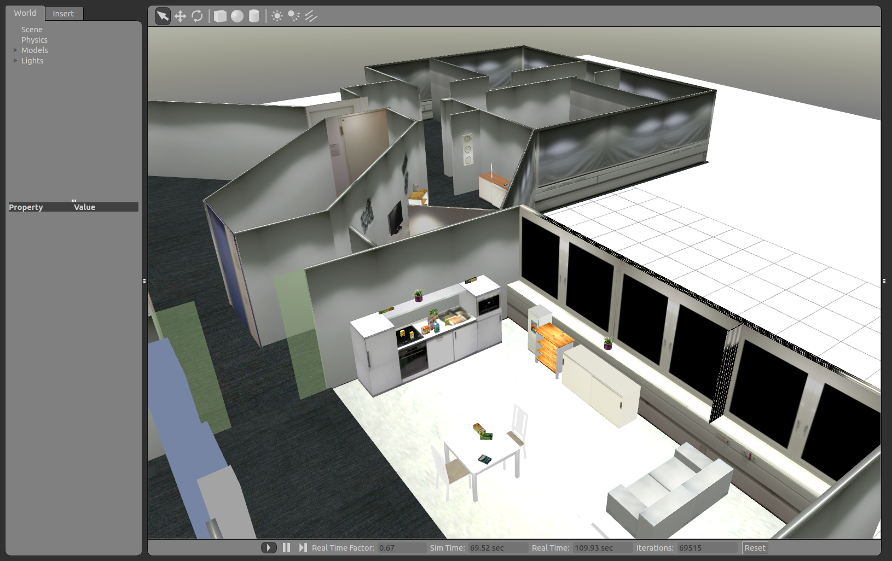
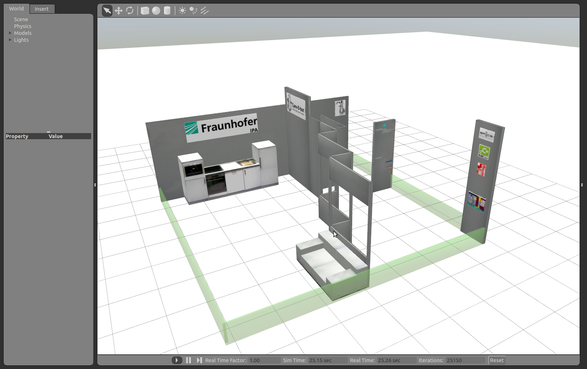

## Available worlds

### ipa-apartment



### ipa-kitchen



## Tutorials

- [Create your own world](#create-your-own-world):
  This tutorial shows how to model your own world and add it to gazebo

## Create your own world

- **Description:** This tutorial shows how to model your own world and
  add it to gazebo

### Modelling

In general: avoid zero thickness for planes, this will cause rendering
problems

#### Model the world using urdf

see
[Building a Visual Robot Model with URDF from Scratch](https://index.ros.org/p/urdf)

#### Model the worlds using Google Sketchup

1\. Model your world in [Google Sketchup](http://sketchup.google.com)
using SI-Units, e.g. meter.

2\. Export to dae format in Sketchup

3\. Put the resulting dae file into the package *cob_gazebo_worlds* into
the folder *Media/models*/. The folder with the textures (same name as
dae-filename) should also be added to this folder.

4\. Create a new world file in the package *cob_gazebo_worlds* in the
folder *common/worlds* named "YOUR_NEW_ENVIRONMENT.world". You can use
the following template and replace the dae filenames in line 23 and line
28. Note the scaling in order to reduce the model to metric values
(SketchUp is using inch when exporting). 

```xml
<?xml version="1.0"?> 
<gazebo version="1.0">
<world name="default">
    <scene>
      <ambient rgba="0.5 0.5 0.5 1"/>
      <background rgba="0.5 0.5 0.5 1"/>
      <shadows enabled="false"/>
    </scene>

    <physics type="ode">
      <gravity xyz="0 0 -9.8"/>
      <ode>
        <solver type="quick" dt="0.001" iters="10" sor="1.3"/>
        <constraints cfm="0.0" erp="0.2" contact_max_correcting_vel="100.0" contact_surface_layer="0.001"/>
      </ode>
    </physics>

     <model name="environment_model" static="true">
      <link name="environment_model_link">
        <origin pose="-10 -25 0 0 0 0"/>
        <collision name="environment_model_collision">
          <geometry>
            <mesh filename="Industriestrasse.dae" scale="0.0254 0.0254 0.0254"/>
          </geometry>
        </collision>
        <visual name="environment_model_visual" cast_shadows="false">
          <geometry>
            <mesh filename="Industriestrasse.dae" scale="0.0254 0.0254 0.0254"/>
          </geometry>
        </visual>
      </link>
    </model>

    <!-- Ground Plane -->
    <model name="plane1_model" static="true">
      <link name="body">
        <collision name="geom_1">
          <geometry>
            <plane normal="0 0 1"/>
          </geometry>
          <surface>
            <friction>
              <ode mu="10.0" mu2="10.0" fdir1="0 0 0" slip1="0" slip2="0"/>
            </friction>
            <bounce restitution_coefficient="0" threshold="1000000.0"/>
            <contact>
              <ode soft_cfm="0" soft_erp="0.2" kp="1e10" kd="1" max_vel="100.0" min_depth="0.0001"/>
            </contact>
          </surface>
        </collision>

        <visual name="visual_1" cast_shadows="false">
          <geometry>
            <plane normal="0 0 1"/>
          </geometry>
          <material script="Gazebo/Grey"/>
        </visual>
      </link>
    </model>

    <light type="directional" name="my_light" cast_shadows="false">
      <origin pose="0 0 30 0 0 0"/>
      <diffuse rgba=".9 .9 .9 1"/>
      <specular rgba=".1 .1 .1 1"/>
      <attenuation range="20"/>
      <direction xyz="0 0 -1"/>
    </light>
  </world>
</gazebo>
```


5\. Create a new "YOUR_NEW_ENVIRONMENT.launch" launch file in the
package *cob_gazebo_worlds* in the folder *ros/launch* with the content:


```xml
<?xml version="1.0"?>
<launch>
	<!-- start gazebo world from .world file -->
	<include file="$(find cob_gazebo_worlds)/ros/launch/world.launch" />
</launch>
```


6\. Export `ROBOT_ENV` to your new world name and start
[simulation](https://index.ros.org/p/cob_bringup_sim)

#### Articulate your world

see
[Building a Movable Robot Model with URDF](https://index.ros.org/p/urdf)

example is elevator in ipa-apartment
